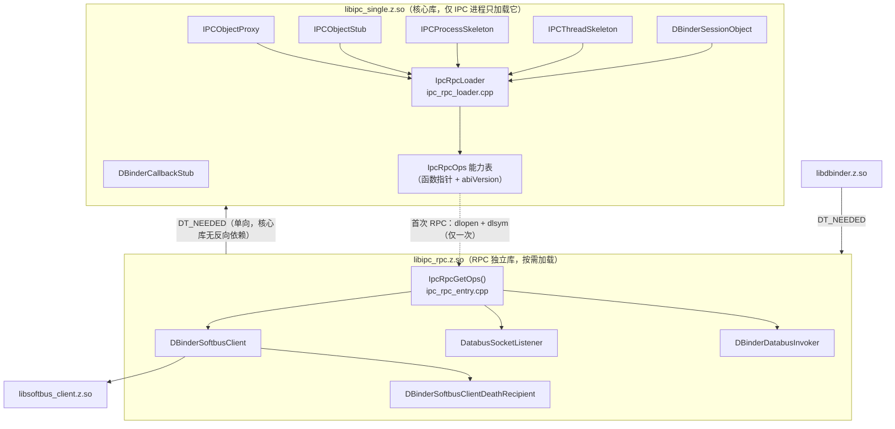
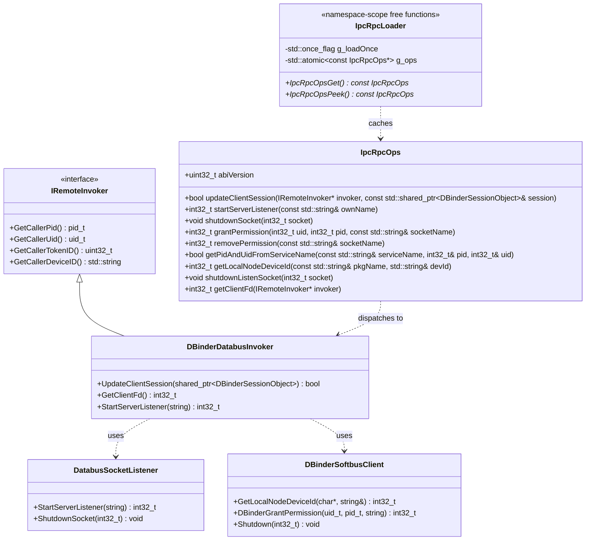
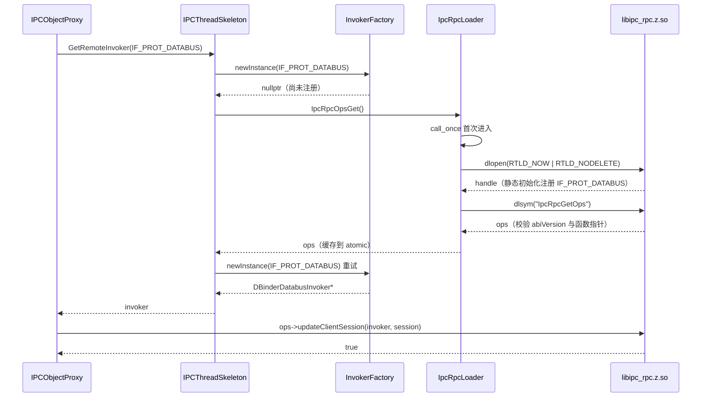
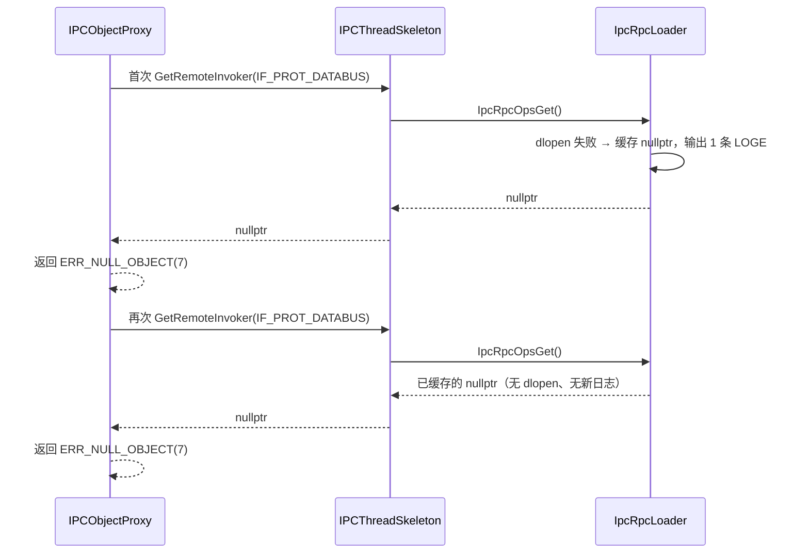

## 会话记录

<!-- 从 .sessions.json sidecar 镜像（由 skill 自动填充，勿手动编辑） -->
| Session ID | Skill | 时间(UTC) | 操作 |
|------------|-------|----------|------|
| ses_e30c4a9c3ffeXW2oydHcNICAXE | odk-design | 2026-11-12T12:21:15Z | 生成 |

# Design

> 本文拥有满足 spec 契约的内部方案与设计约束。内部方案改变且契约仍成立时，
> 更新受影响设计/计划并复验；不得仅为反映新实现而修改 spec。

## 需求基线摘要

需求基线见 `proposal.md`，对外行为契约见 `spec.md`。设计阶段的额外要点：

| 需求 | 设计关注点 |
|------|-----------|
| US-1 / AC-1.1、AC-1.2 | 核心库不得对 RPC 库产生 `DT_NEEDED`；仅 IPC 路径不得触达加载逻辑；核心库剥离后体积下降 ≥10%、`.text` 下降 ≥20% |
| US-2 / AC-2.1~AC-2.3 | 首次 RPC 调用成功；死亡通知与会话生命周期语义不变；错误码、权限校验与认证判定不变 |
| US-3 / AC-3.1~AC-3.3 | 加载不可用时返回既有错误码且进程存活；进程内只尝试一次；并发首次调用互不影响 |
| US-4 / AC-4.1 | 构建开关关闭时回退为拆分前单库结构（静态链接同一批 TU） |
| US-5 / AC-5.1 | 设备内 IPC 热路径不引入按次 `dlopen`/`dlsym`、不加新锁 |
| US-6 / AC-6.1 | 四类场景（仅 IPC 不加载 / 首次 RPC 成功 / RPC 不可用降级 / 开关关闭回退）均有可执行用例 |

设计需同时满足 `spec.md` 的 BR-1~BR-7 与 EX-1~EX-6；本文件只描述内部实现机制，不改变 spec 已约定的对外行为。

## 代码事实基线

| 事实项 | 代码引用（文件:行） | 对设计的约束 |
|--------|-------------------|-------------|
| 6 个 DBinder 编译单元与核心 TU 同属 `libipc_single.z.so` | `interfaces/innerkits/ipc_single/BUILD.gn:45-76`、`:102` | 必须拆分源码集合，再新增独立库目标，不能只改依赖关系 |
| `InvokerDelegator<DBinderDatabusInvoker>` 以 `static inline` 对象在静态初始化期注册 `IF_PROT_DATABUS` | `ipc/native/src/core/dbinder/include/dbinder_databus_invoker.h:123` | 核心库不得再包含该头，否则注册点落到核心库并产生对实现的链接依赖；注册必须随 rpc 库加载发生 |
| RPC invoker 获取入口 | `ipc/native/src/core/framework/source/ipc_thread_skeleton.cpp:204-240` | 加载触发点唯一挂在此处：`newInstance` 返回 `nullptr` 后加载再重试 |
| `SendRequestInner` 在 invoker 为 `nullptr` 时返回 `ERR_NULL_OBJECT`(7) | `ipc/native/src/core/framework/source/ipc_object_proxy.cpp:230-239` | 加载失败语义直接复用既有错误返回，不新增错误码 |
| stub 侧在 invoker 为 `nullptr` 时返回 `IPC_STUB_INVALID_DATA_ERR`(303) | `ipc/native/src/core/framework/source/ipc_object_stub.cpp:239-243,274-278,307-311` | 桩侧降级路径已有确定返回，不需要额外分支 |
| `IPCObjectStub` 对 invoker 的依赖只有 `GetClientFd()` 不在 `IRemoteInvoker` 上 | `ipc/native/src/core/framework/source/ipc_object_stub.cpp:239,274,307`；`ipc/native/src/core/invoker/include/iremote_invoker.h` | 其余 getter 改为基类虚函数调用；仅 `GetClientFd` 进能力表 |
| `IPCObjectProxy` 对 `DatabusSocketListener`/`DBinderDatabusInvoker` 的引用点 | `ipc_object_proxy.cpp:1066-1115,1133,1168,1190-1227` | 收敛为能力表调用；会话对象本身仍由核心库持有 |
| `DBinderSessionObject` 对 `DatabusSocketListener` 的唯一耦合 | `ipc/native/src/core/dbinder/source/dbinder_session_object.cpp:39-50`；`dbinder_session_object.h:23` | 删除该 include，`ShutdownSocket` 改走能力表；`SOCKET_ID_INVALID` 由 `ipc_types.h:87` 提供 |
| `ipc_process_skeleton` 的 SoftBus/Databus 引用 | `ipc_process_skeleton.h:37`；`ipc_process_skeleton.cpp:42,113,534-547,1296-1333` | 头文件去耦合；`Shutdown`/`GetLocalDeviceID`/`CreateSoftbusServer` 改走能力表 |
| `BinderInvoker::GetLocalDeviceID()` 返回空串 | `ipc/native/src/core/invoker/source/binder_invoker.cpp:1704` | 本地 IPC 调用 `IPCSkeleton::GetLocalDeviceID()` 不会触达 rpc 侧实现 |
| 仓内已有 `dlopen` 单次失败日志先例 | `ipc/native/src/core/dbinder/source/dbinder_softbus_client.cpp:142-163` | loader 复用 `RTLD_NOW \| RTLD_NODELETE` + 单次 `LOGE` 的写法 |
| 导出表已为 `libdbinder` 分块导出 `DBinderSoftbusClient::*` | `interfaces/innerkits/ipc_single/libipc_single_map:19-26,157,202` | 需新增 `/* used by libipc_rpc */` 分块，并把 `DBinderSoftbusClient::*` 迁到 rpc 的 map |
| `libdbinder` 直接调用 `DBinderSoftbusClient::GetInstance()` | `ipc/native/src/core/dbinder/source/dbinder_remote_listener.cpp:152-345`、`dbinder_service.cpp:75,824` | `libdbinder` 必须新增对 `ipc_rpc` 的依赖 |
| 核心库经 `ipc_core` 预编译目标安装并建立 symlink | `interfaces/innerkits/ipc_core/BUILD.gn:29-60` | rpc 库必须与核心库同目录安装，保证 `dlopen` 与 `DT_NEEDED` 都能解析 |
| 单测通过 `defines=["private = public"]` 直接访问 dbinder 私有成员 | `test/unittest/ipc/native/core/BUILD.gn:48-51`、`ipc_object_stub_unittest.cpp:917` 等 | 测试目标必须保持全部 TU 在同一 so 内，不能改为跨库访问 |
| `CONFIG_IPC_SINGLE` 在本仓 gn 中从未定义 | `config.gni`、`interfaces/innerkits/ipc_single/BUILD.gn` | `#ifndef CONFIG_IPC_SINGLE` 的 RPC 分支全部参与编译，拆分对全部产品生效 |
| 4 个待迁 TU 的 `.text` 实测占比 | 基线 `libipc_single.z.so`：`.text`=289,951 B；`dbinder_databus_invoker.cpp`=55,436 B、`databus_socket_listener.cpp`=17,785 B、`dbinder_softbus_client.cpp`=9,439 B、`dbinder_softbus_client_death_recipient.cpp`=361 B | 合计 83,021 B = 28.63%，满足 AC-1.2 的 `.text` ≥20%；无需迁移 `dbinder_session_object.cpp`/`dbinder_callback_stub.cpp` |

## 设计约束

1. 公开契约不变：不修改 `interfaces/innerkits/ipc_core/include/` 下任何声明；不改 `ipc_object_proxy.h`/`ipc_object_stub.h` 的虚函数与成员布局（无 ABI 变更）。
2. 依赖方向单向：`libipc_rpc.z.so` 依赖 `libipc_single.z.so`；核心库不得出现对 `libipc_rpc.z.so` 的 `DT_NEEDED`，只能运行期 `dlopen`。
3. 加载尝试进程内至多一次；失败结果缓存，后续调用不重试、不重复输出同类日志。
4. 加载触发只能发生在真实 RPC 路径；设备内 IPC 热路径不得包含 `dlopen`/`dlsym`，也不得新增锁。
5. 加载失败不得绕过或削弱任何权限校验、认证与授权判定；失败返回沿用既有错误码。
6. 构建开关 `ipc_feature_rpc_split_enabled` 关闭时，源码集合、链接方式与产物依赖结构回到拆分前状态。
7. 跨库能力表只使用 C 链接的静态常量结构与函数指针；参数限于仓内已有类型，两端由同一工具链与同一 C++ 运行库构建（`is_cfi=false`，无跨 DSO CFI）。
8. 新增符号仅用于仓内跨库协作，不进入 SDK、不改变既有导出集合的对外语义。
9. 变更仅限 `foundation/communication/ipc` 单仓；仓外消费方无需重新编译。

## 非目标

- 不拆分或改造 `libdbinder`、NAPI/ANI/Taihe/Rust 绑定层的对外能力（仅同步依赖关系）。
- 不优化 Binder 驱动、线程池、序列化等设备内 IPC 热路径。
- 不改变设备发现、认证、授权与权限校验逻辑，不改变 SoftBus 协议交互。
- 不新增对外错误码，不为 RPC 加载失败新增公开状态查询接口。
- 不做 so 内函数级裁剪（如按符号 GC、LTO 策略调优）来凑体积指标。
- 不在本次验收**真机** RSS/PSS 数值（模拟器进程级 PSS 见 `evidence/task-7-device/summary.md`；真机列为未验证项并给出方法）。
- 不提供 RPC 卸载/回收机制；加载后在本进程生命周期内保持（`RTLD_NODELETE`）。

## 方案概述

采用「私有能力表 + 首次 RPC 使用时按需加载」的二进制拆分方案。核心库定义一张 C 链接的函数指针表 `IpcRpcOps`（含 `abiVersion` 与 9 个入口），描述核心侧需要的全部 RPC 能力；RPC 独立库导出唯一入口 `extern "C" const IpcRpcOps *IpcRpcGetOps()` 返回该表。核心库在首次真正需要 RPC invoker 时通过 `dlopen("libipc_rpc.z.so", RTLD_NOW | RTLD_NODELETE)` + `dlsym` 取得能力表并缓存，此后所有跨库调用都走函数指针，不再解析符号。

拆分的物理边界是 4 个编译单元：`dbinder_databus_invoker.cpp`、`databus_socket_listener.cpp`、`dbinder_softbus_client.cpp`、`dbinder_softbus_client_death_recipient.cpp`。选择这 4 个而非全部 6 个 DBinder TU，是因为 `DBinderBaseInvoker<DBinderSessionObject>` 模板的全部实例化代码随 `DBinderDatabusInvoker` 落在 `dbinder_databus_invoker.cpp`，4 个 TU 已达到 `.text` 的 28.63%；保留 `dbinder_session_object.cpp` 与 `dbinder_callback_stub.cpp` 在核心库，可避免核心侧会话对象与死亡通知回调被迫跨库。

加载主触发点：`IPCThreadSkeleton::GetRemoteInvoker(IF_PROT_DATABUS)` 中 `InvokerFactory::newInstance` 首次返回 `nullptr` 时调用能力表访问器，加载成功后重试一次；`dlopen` 完成后 rpc 库的静态初始化会完成 `IF_PROT_DATABUS` 的 invoker 注册。RPC 业务入口保留 `IpcRpcOpsGet()` 作为防御性兜底（`call_once` 幂等，不产生第二次加载）。关闭类路径（`IPCProcessSkeleton::~IPCProcessSkeleton`、`DBinderSessionObject::CloseDatabusSession`）只读取已缓存表，绝不触发加载，避免析构期 `dlopen`。

构建侧新增开关 `ipc_feature_rpc_split_enabled`（默认 `true`）。开启时新增 `ohos_shared_library("ipc_rpc")` 目标并让核心库移除 4 个 TU；关闭时 4 个 TU 与 entry TU 仍编入 `ipc_single`，以 `IPC_RPC_STATIC_LINK` 直接静态调用 `IpcRpcGetOps()`，不产生第二个 so、不 `dlopen`，产物依赖结构与拆分前一致。

## 架构图

## 类图

## 模块影响

| 子系统 | 仓库 | 模块/路径 | 影响类型 | 相关设计决策 |
|--------|------|-----------|---------|-------------|
| foundation/communication | communication_ipc | `interfaces/innerkits/ipc_single/BUILD.gn`、`libipc_single_map` | 拆分源码集合、新增 `ipc_rpc` 目标、新增导出分块 | D-01, D-04, D-06 |
| foundation/communication | communication_ipc | `ipc/native/src/core/dbinder/source/dbinder_databus_invoker.cpp`、`databus_socket_listener.cpp`、`dbinder_softbus_client.cpp`、`dbinder_softbus_client_death_recipient.cpp` | 迁出到 RPC 独立库 | D-01, D-04 |
| foundation/communication | communication_ipc | 新增 `ipc/native/src/core/dbinder/include/ipc_rpc_ops.h`、`ipc/native/src/core/dbinder/source/ipc_rpc_loader.cpp`、`ipc/native/src/core/dbinder/source/ipc_rpc_entry.cpp`（含对应私有头） | 新增仓内私有能力表、加载器与入口 | D-01, D-03, D-05 |
| foundation/communication | communication_ipc | `ipc/native/src/core/framework/source/ipc_object_proxy.cpp`、`ipc_object_stub.cpp` | RPC 调用点改为能力表/基类虚函数 | D-01, D-02 |
| foundation/communication | communication_ipc | `ipc/native/src/core/framework/source/ipc_process_skeleton.cpp`、`ipc/native/src/core/dbinder/source/dbinder_session_object.cpp`、`dbinder_session_object.h`、`ipc_process_skeleton.h` | 头文件解耦、关闭路径改走已缓存能力表 | D-01, D-05, D-09 |
| foundation/communication | communication_ipc | `interfaces/innerkits/ipc_core/BUILD.gn` | 安装 RPC 独立库到核心库同目录 | D-06 |
| foundation/communication | communication_ipc | `interfaces/innerkits/libdbinder/BUILD.gn` | 追加 `ipc_rpc` 依赖 | D-08 |
| foundation/communication | communication_ipc | `config.gni` | 新增 `ipc_feature_rpc_split_enabled` 开关 | D-06 |
| foundation/communication | communication_ipc | `test/BUILD.gn`、`test/unittest/ipc/native/core/BUILD.gn`、`test/unittest/**` | 测试目标同步拆分与静态链接模式 | D-07 |

## 实现入口

| Entry Point | 代码引用（文件:行） | 当前职责 | 调用方 | 被调用方 | 预期变更 |
|-------------|-------------------|----------|--------|----------|----------|
| `IPCThreadSkeleton::GetRemoteInvoker` | `ipc_thread_skeleton.cpp:204-240` | 按协议获取/创建 invoker | `SendRequestInner`、stub 事务、`IPCSkeleton` | `InvokerFactory::newInstance` | `newInstance` 返回 `nullptr` 时调用 `IpcRpcOpsGet()` 并重试一次（D-02） |
| `IPCObjectProxy::MakeDBinderTransSession` | `ipc_object_proxy.cpp:1066-1115` | 建立 DBinder 会话 | `SendRequestInner` RPC 协商 | `DBinderDatabusInvoker::UpdateClientSession` | 改为 `ops->updateClientSession(invoker, session)`（D-01） |
| `IPCObjectProxy::GetDBinderNegotiationData` | `ipc_object_proxy.cpp:1133,1168` | 查询对端 pid/uid | RPC 协商 | `DatabusSocketListener::GetPidAndUidFromServiceName` | 改为 `ops->getPidAndUidFromServiceName`（D-01） |
| `DBinderSessionObject::CloseDatabusSession` | `dbinder_session_object.cpp:39-50` | 关闭 databus socket | 会话释放/失败回滚 | `DatabusSocketListener::ShutdownSocket` | 改为 `IpcRpcOpsPeek()->shutdownSocket(socket_)`，表为空则只置 `SOCKET_ID_INVALID`（D-09） |
| `IPCProcessSkeleton::CreateSoftbusServer` | `ipc_process_skeleton.cpp:1296-1333` | 启动监听 socket | RPC 会话建立 | `DatabusSocketListener::StartServerListener` | 改为 `ops->startServerListener(name)`（D-01） |
| `IPCProcessSkeleton::GetLocalDeviceID` | `ipc_process_skeleton.cpp:534-547` | 取本端 networkId | RPC 路径 | `DBinderSoftbusClient::GetLocalNodeDeviceId` | 改为 `ops->getLocalNodeDeviceId`（D-01） |
| `IPCProcessSkeleton::~IPCProcessSkeleton` | `ipc_process_skeleton.cpp:95-116` | 进程退出清理监听 socket | 进程退出 | `DBinderSoftbusClient::Shutdown` | 改用 `IpcRpcOpsPeek()`，未加载则跳过（D-09） |
| `IPCObjectStub::DBinderIncRefsTransaction`/`DecRefs`/`AddCommAuth` | `ipc_object_stub.cpp:239,274,307` | 读取调用方信息与客户端 fd | stub 事务分发 | `DBinderDatabusInvoker` getter | getter 改用 `IRemoteInvoker` 虚函数；`GetClientFd` 改为 `ops->getClientFd(invoker)`（D-01） |
| `IPCObjectStub::CreateSessionName`/`RemoveSessionName` | `ipc_object_stub.cpp:773-799` | 创建会话名时授予权限、清理时撤销权限 | 会话协商/`RemoveSessionName` 事务 | `DBinderSoftbusClient` | 改为 `ops->grantPermission`/`ops->removePermission`，判定逻辑与错误码不变（D-01） |
| `IPCProcessSkeleton::RemoveSoftbusServer` | `ipc_process_skeleton.cpp:1335-1355` | 清理会话名并通知 SAMgr | 服务退出 | `IPCObjectProxy::RemoveSessionName` | 不改调用链；仅确认不再直接引用 rpc 符号 |
| `ipc_single` 目标 | `interfaces/innerkits/ipc_single/BUILD.gn:45-76,102` | 核心库构建 | 构建系统 | - | 移除 4 个 TU；新增 `ipc_rpc` 目标（D-06） |
| 导出表 | `interfaces/innerkits/ipc_single/libipc_single_map:19-26,157,202` | 控制导出符号 | 链接器 | - | 新增 `/* used by libipc_rpc */` 分块；`DBinderSoftbusClient::*` 迁至 `libipc_rpc_map`（D-04） |
| 安装装配 | `interfaces/innerkits/ipc_core/BUILD.gn:29-60` | 安装核心库与 symlink | 构建系统 | - | 追加 `libipc_rpc.z.so` 的同目录安装（D-06） |

## 既有模式复用

| Pattern | 参考代码（文件:行） | 复用方式 | 适用 Task |
|---------|-------------------|----------|-----------|
| 运行时按需加载 + 单次失败日志 | `dbinder_softbus_client.cpp:142-163` | `dlopen(RTLD_NOW \| RTLD_NODELETE)` + `dlsym`，失败只 `LOGE` 一条并缓存空表 | T-03 |
| 私有符号分块导出 | `libipc_single_map:19-26` | 以 `/* used by libipc_rpc */` 分块集中导出 rpc 侧所需核心符号，保留 `local: *` 收口 | T-05 |
| 静态注册 invoker | `dbinder/include/dbinder_databus_invoker.h:123` | rpc 库加载时由静态对象完成 `IF_PROT_DATABUS` 注册，核心侧不做显式注册 | T-02 |
| 复用既有错误返回 | `ipc_object_proxy.cpp:230-239`、`ipc_object_stub.cpp:239-243` | 加载失败直接落到 `ERR_NULL_OBJECT`/`IPC_STUB_INVALID_DATA_ERR`，不新增错误码 | T-04 |
| 日志脱敏 | `ipc_process_skeleton.cpp:122-131` `ConvertToSecureString` | 新日志涉及 deviceId/sessionName 时沿用脱敏输出，不打印明文 | T-03, T-04 |
| 单测同 so 访问私有成员 | `test/unittest/ipc/native/core/BUILD.gn:48-51` | 测试目标保留全量 TU 并静态链接 entry/loader（`IPC_RPC_STATIC_LINK`） | T-08 |

## 关键设计决策

| 决策 ID | 问题 | 推荐方案 | 备选方案 | 选择理由 |
|---------|------|----------|----------|---------|
| D-01 | 核心库如何调用已迁出的 RPC 实现 | 定义 C 链接静态常量结构 `IpcRpcOps`（`abiVersion` + 9 个函数指针），rpc so 导出唯一入口 `extern "C" const IpcRpcOps *IpcRpcGetOps()`；核心侧只在取得表时 `dlsym` 一次 | (a) rpc 侧导出 9 个独立 C 函数逐个 `dlsym`；(b) 保留一个跨库抽象基类用虚函数调用 | 能力表把跨库边界收敛为一处、一次解析、集中做版本校验；不引入跨 DSO vtable，避免 ABI/CFI 复杂度；逐个 `dlsym` 会产生 9 次解析且分散失败处理。核心侧因此不再命名 `DBinderDatabusInvoker` 类型、不再 include `dbinder_databus_invoker.h`，`GetRemoteInvoker` 的结果统一按 `IRemoteInvoker*` 传递，避免把静态注册点带回核心库 |
| D-02 | 在何处触发 RPC 实现加载 | 主挂载点：`IPCThreadSkeleton::GetRemoteInvoker(IF_PROT_DATABUS)` 中 `InvokerFactory::newInstance` 首次返回 `nullptr` 后调用 `IpcRpcOpsGet()`，成功后重试一次 `newInstance`。其余 `IpcRpcOpsGet()` 调用点全部位于 RPC 业务入口（stub 的 refs/commAuth/session 事务、proxy 的会话建立、`CreateSoftbusServer`/`GetLocalDeviceID`），且要么以 `GetRemoteInvoker(IF_PROT_DATABUS)` 成功为前提，要么本身就是跨设备入口；`call_once` 幂等，不会产生第二次加载 | (a) `IPCSkeleton` 初始化时预加载；(b) 每个 RPC 调用点各自 `ensureLoaded` | 所有 RPC 入口都会经过 invoker 获取，主挂载点即可覆盖纯 IPC 进程不加载的目标；业务入口保留 `Get()` 作为「invoker 经其他路径可用但表未取」的防御性兜底，表已加载时仅为 `call_once` 快路径 + acquire load；避免在多个调用点重复判断 |
| D-03 | 加载失败与并发首次调用如何处理 | `std::call_once` 保证进程内至多一次加载；结果写入 `std::atomic<const IpcRpcOps *>`，失败缓存 `nullptr`；失败只输出一条 `LOGE`，调用点不再重复输出同类日志 | (a) 每次调用加互斥锁重试；(b) 失败后允许下次调用重试 | 满足 BR-3/EX-2/EX-3：失败稳定、不重试、不刷日志；`call_once` 的实现自带并发去重；热读用 atomic acquire，不引入新锁 |
| D-04 | 跨 DSO 依赖的核心内部符号如何可见 | 在 `libipc_single_map` 增加 `/* used by libipc_rpc */` 导出分块，清单由 `llvm-nm -u --demangle` 对 rpc 侧 bitcode 提取，配合 `-Wl,--no-undefined` 迭代收敛；`libipc_rpc_map` 只导出 `IpcRpcGetOps` 与必要的类型符号 | (a) 核心库导出全部符号；(b) 把共享实现复制到 rpc 库 | 保持仓内既有 `local: *` 符号收口惯例（先例：`DBinderSoftbusClient::*` 为 `libdbinder` 导出）；避免把内部实现意外变成对外可见面；复制实现会造成双份状态 |
| D-05 | 哪些 DBinder 状态留在核心库 | 仅迁出 4 个 TU（databus invoker、socket listener、softbus client 及其 death recipient）；`DBinderSessionObject`、`DBinderCallbackStub` 留在核心库 | (a) 6 个 TU 全部迁出；(b) 只迁 invoker | 会话对象与死亡通知回调被核心侧生命周期直接持有，迁出会迫使核心跨库管理回调注册；`DBinderBaseInvoker<DBinderSessionObject>` 的全部实例化代码随 databus invoker 落在同一 TU，4 个 TU 已占 `.text` 28.63%，满足 AC-1.2 |
| D-06 | 如何提供可回退的构建形态 | 新增 `ipc_feature_rpc_split_enabled`（默认 `true`）；开启时新增 `ohos_shared_library("ipc_rpc")` 并从核心库移除 4 个 TU；关闭时 4 个 TU 与 entry TU 继续编入 `ipc_single`，定义 `IPC_RPC_STATIC_LINK`，`IpcRpcGetOps()` 直接静态调用 | (a) 用代码分支/宏删除实现；(b) 只保留单库、不提供开关 | 开关只影响构建装配，不改业务代码；关闭态产物依赖结构与拆分前一致，可满足 AC-4.1；默认开启符合 7.1 目标 |
| D-07 | 单元测试如何覆盖拆分后的两条链路 | `ipc_single_test`/`ipc_single_test_static` 保持全部 TU 编译进同一 so，并追加 `ipc_rpc_entry.cpp` + `ipc_rpc_loader.cpp`，定义 `IPC_RPC_STATIC_LINK`；loader 在该宏下直接 `extern` 调用 `IpcRpcGetOps()` | (a) 测试也走 `dlopen`；(b) 拆出独立测试 so | 现有单测通过 `defines=["private = public"]` 直接访问 dbinder 私有成员，必须同 so；静态链接路径不依赖安装目录，测试可在构建目录直接运行；`dlopen` 路径由构建产物 `readelf` 检查与设备侧用例覆盖 |
| D-08 | `libdbinder` 如何获得迁出的 SoftBus 能力 | `interfaces/innerkits/libdbinder/BUILD.gn` 的 deps 追加 `ipc_rpc`，形成 `libdbinder → libipc_rpc → libipc_single` 单向依赖链 | (a) 让 `libdbinder` 也改走能力表；(b) 把 `DBinderSoftbusClient` 留在核心库 | `libdbinder` 是 RPC 专用消费方（`dbinder_remote_listener.cpp`、`dbinder_service.cpp` 直接调用 `DBinderSoftbusClient::GetInstance()`），直接依赖语义清晰；改走能力表会复制加载逻辑并扩大改动面；把 client 留在核心库会破坏拆分目标 |
| D-09 | 退出/析构路径是否需要加载 RPC | 提供两个访问器：`IpcRpcOpsGet()`（懒加载，`call_once`）用于真实 RPC 入口；`IpcRpcOpsPeek()`（只读缓存，不触发加载）用于 `IPCProcessSkeleton::~IPCProcessSkeleton`、`DBinderSessionObject::CloseDatabusSession` 等关闭路径 | (a) 统一使用 `Get()`；(b) 关闭路径直接跳过 rpc 清理 | 避免进程退出或对象析构期间 `dlopen`，防止退出卡顿、退出期日志噪声与静态析构顺序问题；符合 BR-7「只在真正发生跨设备调用时加载」；未加载时 rpc 侧本就没有 socket 需要清理 |

<!-- 不涉及：资源设计；理由：proposal.md 资源开销审视中性能、内存(RAM)、存储(ROM)三维均为 waived（已由需求方确认接受，资源链路不激活）；本变更的资源收益与验证方式已在「验证思路」中按体积/依赖指标给出，证据见 evidence/task-6/。 -->

## 状态归属与不变量

**Ownership**

- 能力表 `IpcRpcOps` 由 rpc so 以静态常量持有，核心库只保存 `const IpcRpcOps *`；`RTLD_NODELETE` 保证其生命周期覆盖整个进程，核心侧不存在释放责任。
- `DBinderSessionObject` 仍由核心库 `IPCProcessSkeleton` 以 `shared_ptr` 拥有；rpc 侧在 `updateClientSession` 调用期间借用引用，不跨调用保存裸指针。
- 不变量：`ops_` 非空时 `abiVersion == IPC_RPC_OPS_ABI_VERSION` 且 9 个函数指针全部非空。entry 使用全量指定初始化，禁止部分填充；任一条件不满足时 loader 视为加载失败。
- 不变量：**RPC 能力可用性的唯一判据是 `ops != nullptr`**。`InvokerFactory::newInstance` 返回非空 invoker 只说明 rpc so 已被加载并完成静态注册，不能因此推断能力表可用；调用点必须先取 ops、判空、再使用 invoker（ABI/完整度校验失败时的半加载状态按不可用处理）。
- 唯一例外：`IPCObjectStub::DBinderAddCommAuth` 只使用 `IRemoteInvoker` 上的虚函数（`GetCallerUid`/`GetCallerPid`），不触碰能力表字段；该处以 `invoker != nullptr` 为门控即可，不额外取 ops，也不因此把 invoker 非空当作能力表可用。新增能力表调用点不得援引本例外。
- 不变量：entry TU 的静态初始化期间禁止调用 `IpcRpcOpsGet()`（允许 `Peek()`），否则会在 `std::call_once` 上自重入死锁；entry 顶部注释与 TASK-3 评审按此核对。
- ABI 前提：能力表参数跨 DSO 传递 `const std::string &` 与 `std::shared_ptr<DBinderSessionObject>`，依赖同一次构建、同一工具链与同一 libc++ 配置；`abiVersion` 只能发现结构布局不一致，不覆盖 STL ABI 混用，跨镜像混装不在支持范围。
- 加载路径信任（**TASK-3 已决议**）：`dlopen` 不使用裸库名。加载器先用 `dladdr()` 定位核心库自身被装载的文件路径，取其所在目录拼出 `libipc_rpc.z.so` 的绝对路径；该自身路径**必须是绝对路径**，相对路径（相对 `LD_LIBRARY_PATH` 条目或裸名装载）会让拼出的路径随进程 CWD 漂移，直接判为不可解析并 fail-closed（因此产品配置中的库搜索目录必须是绝对路径；本仓默认搜索目录均为绝对路径，不受影响）。`dlopen` 成功后用 `dlsym` 取入口符号，再对**该符号地址**做 `dladdr()`，确认提供入口符号的映像就是请求的那个文件：路径串相等直接通过，否则比较 `stat()` 后的 `st_dev`/`st_ino`。两点都是必需的：
  1. 必须用 `dladdr(入口符号)` 而不是 `dlinfo(handle, RTLD_DI_LINKMAP)`。本仓 musl 在非 asan/tsan 构建中定义 `HANDLE_RANDOMIZATION`（`third_party/musl/musl_template.gni:545`），`dlopen` 返回的是 `handle_node` 里随机生成的 opaque handle（`porting/linux/user/ldso/dynlink_rand.c` 的 `assign_valid_handle`），而 `src/ldso/dlinfo.c` 直接把入参当 `struct dso *` 回填，`__dl_invalid_handle()`（`dynlink.c:3779` 遍历 `head` 比对 dso 指针）会判定随机 handle 非法并返回 -1。也就是说 `dlinfo` 在此平台上恒失败，用它做校验会让 RPC 永久不可用。`dladdr` 接收真实代码地址，且校验对象正是即将被调用的那段代码，比校验 handle 更严格（还能发现符号被抢占）。
  2. 同一文件的两种拼写必须都通过：`libdbinder` 的 `DT_NEEDED` 可能先把该库按搜索路径装载，此时 musl 保留首次装载的路径串，与核心库 own-dir 拼出的绝对路径只是同一文件的两种写法；若坚持字符串全等，这类进程会永久判失败。同名但不同的文件（如被 `LD_LIBRARY_PATH` 抢占的副本）`st_dev`/`st_ino` 不同，仍然 fail-closed，不回退到裸名搜索。路径不可解析或校验不通过时只记一条日志并缓存空表，**不重试**。残余风险（登记于验证章节）：若上游镜像只同步 chipset 目录而漏发 rpc 库，则该目录下 RPC 恒不可用——表现为既有错误码而非崩溃，属可诊断的 fail-closed。

**Lifecycle**

- 创建：首次 `IpcRpcOpsGet()`；无论成功或失败，状态在 `call_once` 返回后即固定。
- 清理：不卸载（`RTLD_NODELETE`），进程退出由系统回收；不提供显式卸载接口。
- 回滚：构建开关关闭时 `IPC_RPC_STATIC_LINK` 生效，`call_once` 体内直接调用同 so 的 `IpcRpcGetOps()`；路径解析、`dlopen`、`dlsym` 与映像校验整段代码在该形态下被条件编译排除（`ipc_rpc_loader.cpp` 的 `#ifndef IPC_RPC_STATIC_LINK`），关闭态产物不含这些调用点，也不产生第二个 so。两种形态共用同一套 ABI 版本与表完整性校验，失败同样缓存空表并只记一条日志。
- 不变量：`dlopen`/`dlsym` 只在开启态 `IpcRpcOpsGet()` 的 `call_once` 体内发生，`IpcRpcOpsPeek()` 只做 atomic load。

**Concurrency**

- 同步模型：`std::once_flag` 保护首次加载，`std::atomic<const IpcRpcOps *>`（release store / acquire load）提供无锁读取。
- 不变量：进入 `dlopen` 时不得持有 `IPCThreadSkeleton::usingFlag_` 之外的框架锁；实际顺序是 `InvokerFactory::newInstance` 返回后才加载，factory 内部锁已释放。`IPCProcessSkeleton::GetLocalDeviceID()` 已把取表移到 `databusProcMutex_` 之外，其余调用点均在无框架锁状态下调用。
- 不变量：并发首次调用只有一个线程执行加载，其余线程在 `call_once` 上等待并复用同一结果（AC-3.3）。
- 验证方法：新增多线程并发首次 RPC 用例；代码审查确认加载点不在锁内。

**Compatibility**

- 状态格式：不新增落盘或跨进程传输格式；`abiVersion` 仅用于同镜像内核心库与 rpc 库的版本一致性校验。
- 版本不匹配视为加载失败，不复用旧布局、不做兼容降级；返回既有错误码。
- 公开头文件、对象布局、错误码与同步/异步语义保持不变（BR-1）。
- 验证方法：`llvm-readelf -d` 检查依赖结构；全量单测与接口对比。

**Performance**

- 设备内 IPC 热路径不调用 `IpcRpcOpsGet()`；`IpcRpcOpsPeek()` 仅出现在 shutdown/析构路径，代价为一次 atomic load。
- 首次 RPC 增加一次性 `dlopen` + `dlsym`；之后每次跨库调用为一次函数指针间接调用。
- 日志：加载失败全进程仅 1 条 `LOGE`；调用点空表分支沿用所在函数既有错误日志。可被对端反复触发的 RPC 事务入口存在日志放大面，已登记为残余风险，由 TASK-5/TASK-6 评估是否降级或限频。
- 关联 AC：AC-5.1、AC-3.2；验证方法为用例时延对比与日志条数检查。

## DFX 设计

### DFX 故障模式分析

| 分析对象 | 故障模式 | 故障影响 | 故障原因 | 严酷度 | 恢复措施 | 关键日志 | 大数据打点事件 | 来源 |
|---------|----------|----------|-------------|---------|---------|---------|---------|------|

不涉及。本次变更不新增可观测故障模式：RPC 加载失败按 `spec.md` EX-1/EX-2 复用既有错误码与降级路径，设备内 IPC 路径行为不变。仓内不存在 DFX 知识库文件 `docs/dfx/fmea.yaml`，无命中记录可填。

不涉及理由：仓无 DFX 知识

> 涉及仓库：communication_ipc

| 仓库 | 状态 | 理由 |
|------|------|------|
| communication_ipc | NO_DFX_KNOWLEDGE | 仓无 DFX 知识 |

补充证据：`foundation/communication/ipc` 下无 `docs/dfx/` 目录，`ls docs/dfx/fmea.yaml` 返回不存在；因此无法引用 `<repo>@<commit>:docs/dfx/fmea.yaml#<record-id>` 形式的来源。

### DFX 故障模式处置

本次主表无命中行且无 AD 推导条目，按模板约定不填本表；加载失败的对外行为已由 `spec.md` 的 EX-1/EX-2 与错误码定义覆盖。

<!-- 不涉及：国际化依赖分析；理由：本次变更为内部二进制拆分与构建装配调整，不涉及任何数据的表达、展示、解析或交互，不产生面向用户的语言/地区相关文案或格式。 -->

## 安全基础检查

### 信任边界交叉分析

| 交互类型 | 边界描述 | 通信双方 | 权限管控机制 | 关联 AC |
|---------|----------|----------|-------------|---------|
| 跨进程 | 同一设备内 Binder IPC 事务 | 应用/系统服务进程 ↔ IPC 库 | 既有 `AccessToken` 与 caller uid/pid/tokenId 校验；本次不修改校验逻辑与顺序 | AC-1.1 |
| 跨设备 | DBinder/Databus 经 SoftBus 的跨设备调用 | 本端进程 ↔ 远端进程 | 既有 `DBinderGrantPermission`/`DBinderRemovePermission`、tokenId 与 uid 校验；本次仅改变实现所在 so，不改变判定 | AC-2.3、AC-3.1 |
| 跨库（本次新增） | 核心库经能力表调用 rpc 库 | `libipc_single` ↔ `libipc_rpc` | 仅仓内私有 ABI：`abiVersion` 精确匹配 + 函数指针全量校验；能力表不对外导出用途说明、不进入 SDK | AC-6.1 |

补充说明：加载失败/版本不匹配时直接返回 `nullptr`，调用方落到既有 `ERR_NULL_OBJECT`(7) 或 `IPC_STUB_INVALID_DATA_ERR`(303)；不存在「加载失败则跳过权限校验」的分支（BR-5）。

### 基础安全要求检查

| 检查项 | 检查结果 | 说明/措施 |
|--------|----------|-----------|
| 加密算法合规 | N/A | 未引入任何加解密算法或密钥派生逻辑 |
| 密钥管理安全 | N/A | 未引入密钥、证书或凭证存储 |
| 随机数安全 | N/A | 未使用随机数 |
| 输入验证完备 | ✅ | `abiVersion` 必须精确匹配、9 个函数指针必须非空、`dlsym` 结果必须非空；任一不满足按加载失败处理，不进入 RPC 实现 |
| 错误处理安全 | ✅ | 加载失败只输出一条不含敏感信息的 `LOGE`；deviceId/sessionName 沿用 `ConvertToSecureString` 脱敏，不打印明文 |
| 配置安全 | ✅ | 新增构建开关默认开启且无运行期调试后门；关闭态回退为拆分前结构，不降低任何校验强度 |

### 敏感数据处理（如适用）

本次变更不涉及敏感数据处理：仅使用既有服务名、设备标识与会话标识，不新增落盘、不新增跨设备传输字段，也不改变既有数据的保护方式。

### 深度威胁分析（如需）

本次仅需上述基础检查：变更不改变认证、授权与权限判定逻辑，不新增网络暴露面，不新增敏感数据，也未引入新协议；仅改变实现所在共享库与加载时机，未触发深度威胁分析条件。

## 时序设计

首次跨设备 RPC 调用（RPC 库可用）：

RPC 库不可用时的重复调用：

## 风险与缓解

| 风险 | 可能性 | 影响 | 缓解措施 |
|------|--------|------|----------|
| rpc 库引用的核心内部符号未导出，导致链接失败或运行期未定义符号 | 中 | 构建失败或首次 RPC 崩溃 | 用 `llvm-nm -u --demangle` 从 rpc 侧 bitcode 提取清单；核心库以 `-Wl,--no-undefined` 构建；全量 `ipc_components` 与 `ipc_unittest` 构建验证 |
| rpc 库安装目录不在动态链接器搜索路径，`dlopen` 失败 | 低 | 首次 RPC 恒失败 | 加载器不依赖搜索路径：以核心库自身 `dladdr()` 目录拼绝对路径打开，并确认提供入口符号的映像为同一文件（`dli_fname` 相等或 `st_dev`/`st_ino` 相同，见「加载路径信任」决议）；`ipc_rpc_core` 与 `ipc_core` 的 `install_images`/`relative_install_dir` 完全一致（system+updater 的 `platformsdk`），两者必须成对安装；设备侧首次 RPC 用例验证 |
| 核心库已按搜索路径拼写被 `DT_NEEDED` 预加载，与 own-dir 绝对路径字符串不同 | 中 | 若按字符串全等校验，该进程 RPC 永久不可用 | 校验改为「同一文件」语义：`dladdr(入口符号)` 的 `dli_fname` 字符串相等直接通过，否则 `stat()` 比较 `st_dev`/`st_ino`；同名异文件仍拒绝。单测用「同文件不同拼写 + 不存在文件 + 空地址」覆盖真实 `dladdr`/`stat` 分支 |
| 用 `dlinfo(RTLD_DI_LINKMAP)` 校验 handle | 高（已消除） | musl 定义 `HANDLE_RANDOMIZATION` 时 `dlopen` 返回随机 opaque handle，`dlinfo` 经 `__dl_invalid_handle` 直接失败，RPC 永久不可用 | 改为 `dladdr(入口符号)` 校验提供符号的映像；单测走真实 `dladdr`+`stat` 分支（该缺陷即由单测 `PreloadedImageWithEquivalentPathIsAccepted` 首次暴露） |
| 镜像只同步 chipset 目录而漏发 rpc 库 | 低 | 该目录下 RPC 恒不可用 | fail-closed：路径解析失败或入口符号映像不匹配即单条日志 + 缓存空表，调用方返回既有错误码，不回退裸名搜索（残余风险，验证章节登记） |
| 核心库以相对路径被装载，own-dir 随 CWD 漂移 | 低（已消除） | 攻击者控制 CWD 时可用同名库抢占 | `DirectoryOfLibraryPath()` 只接受首字符为 `/` 的自身路径，否则返回空 → `ResolveRpcLibraryPath()` 为空 → fail-closed；单测 `RelativeOwnLibraryPathIsRejected` 覆盖 `""`/裸名/`./`/`../` |
| ADLT 打包形态下 `dli_fname` 为 `adlt名:库名` | 低（登记） | own-dir 与 `stat` 均失败，RPC 恒不可用 | `ipc_rpc_ops.h` 的私有 ABI 登记明确「不支持 ADLT」：表现为既有错误码 + 单条日志，不崩溃；支持 ADLT 需另立显式加载契约 |
| `IF_PROT_DATABUS` 注册依赖静态初始化，加载后仍无 invoker | 低 | 首次 RPC 返回 7 | rpc entry TU 显式持有 `DBinderDatabusInvoker` 的静态注册对象；加载后重试一次 `newInstance`；首次 RPC 用例覆盖 |
| 关闭/析构路径触发 `dlopen`，导致退出卡顿或退出期日志噪声 | 中 | 进程退出体验与稳定性 | `IpcRpcOpsPeek()` 只读缓存；代码审查确认 shutdown/析构路径不调用 `Get()`；补充 shutdown 用例 |
| 核心库与 rpc 库版本不一致（混用镜像） | 低 | 未定义行为 | `abiVersion` 精确匹配，不匹配按加载失败处理并返回既有错误码；两侧同一次构建产出、同目录安装 |
| 单元测试仍把全部 TU 编入同一 so，掩盖跨库问题 | 高 | 真实拆分缺陷漏检 | 额外用 `llvm-readelf -d` 断言核心库无 `libipc_rpc.z.so` 依赖；构建 rpc 独立库并检查 `llvm-nm -D` 入口；设备侧首次 RPC 用例验证真实 `dlopen` 路径 |
| 体积目标未达标（AC-1.2） | 低 | 验收失败 | DWARF 实测 4 TU 合计 `.text` 28.63%；实现后再次用 `llvm-readelf -S` 对比基线，若不达标再评估增迁 TU |
| `libdbinder` 新增依赖引入循环 | 低 | 构建失败 | 依赖方向固定为 `libdbinder → ipc_rpc → ipc_single`；核心库不反向依赖；构建系统链接期验证 |
| `DBinderSessionObject::CloseDatabusSession` 使用 `Peek()`，若 core 从未取表而 rpc 侧已创建会话（如经 `libdbinder → libipc_rpc` 直接进入），`shutdownSocket` 会被跳过、socket fd 残留 | 低 | 进程生命周期内 fd 泄漏 | TASK-4 建立 `DT_NEEDED` 后必须审计所有 `DBinderSessionObject` 创建路径：能创建会话的路径必须已触发 core 侧 `IpcRpcOpsGet()`；不满足时改为 rpc 侧自管关闭或使用受控 `Get()`。TASK-5/6 在依赖图上核对 |
| 关闭态导出面未回退到拆分前（245 vs 167） | 确定（已接受） | `BR-6`「产物结构与拆分前一致」在导出面上不成立；关闭态核心库仍导出 78 条 `/* used by libipc_rpc */` 条目，代价为 `.plt` +1,200 B、`JUMP_SLOT` +75、ALLOC +1,290 B | 两种形态共用同一张 `libipc_single_map`，版本脚本无法按开关分支；复制第二份 190 行 map 的长期漂移风险高于收益。功能、`DT_NEEDED` 与运行行为均与拆分前一致（`comm` 比对无基线符号丢失）。已在 `config.gni` 注释、TASK-4 证据与 TASK-6 体积表口径中显式声明；若治理要求严格回退，再引入条件化版本脚本 |
| 跨 DSO 共享头文件的宏定义不一致导致静默 ODR/枚举错位 | 中（已缓解） | 同一类在核心库与 rpc 库得到不同布局或枚举值，`abiVersion` 只校验能力表结构，发现不了 | `interfaces/innerkits/ipc_single/BUILD.gn` 新增 `config("ipc_rpc_abi_defines")` 作为唯一真源，`ipc_single`、`ipc_rpc`、`ipc_single_test` 统一 `configs +=`；后续新增会改变头文件内容的宏必须同时进该 config |
| 测试 so 的导出面与产品产物不同，用例全绿不能证明产品符号不可见/不可抢占 | 低（已登记） | 测试 so 无版本脚本，`IpcRpcGetOps`/`IpcRpcOpsGet`/`IpcRpcOpsPeek` 被导出且经 `JUMP_SLOT` 调用；若 `libipc_single_map` 被误改，测试仍全绿 | 测试 so 必须能链接 `IpcRpcGetOps`，不为其加 `local: *`；改由 TASK-6 对产品产物做二进制断言（关闭态 `nm -D \| grep -ic ipcrpc == 0` 且 `readelf -r \| grep -c IpcRpc == 0`） |
| 能力表为空时析构路径跳过 `shutdownListenSocket` | 低（有意设计） | 监听 socket 在「从未加载/加载失败」的进程里不关闭 | teardown 期间不允许触发装载是刻意设计，避免退出期 `dlopen`；静态形态加载期即通过校验，该分支不可达；不构成权限绕过 |

## 验证思路

| 验证场景 | 方法 | 通过标准 |
|----------|------|----------|
| 核心库不强制依赖 RPC（AC-1.1/BR-4） | `llvm-readelf -d libipc_single.z.so` | 动态依赖中不含 `libipc_rpc.z.so` |
| 核心库体积下降（AC-1.2） | `stat` 与 `llvm-readelf -S` 对比拆分前基线 | 剥离后文件体积下降 ≥10%，`.text` 下降 ≥20% |
| RPC 能力以独立库交付（AC-1.2） | 检查 `libipc_rpc.z.so` 存在并随镜像安装 | 库存在，`llvm-nm -D` 可见 `IpcRpcGetOps` |
| 跨库符号完整（AC-2.1） | rpc 侧 `llvm-nm -u` + 全量 `ipc_components` 链接 | 无未定义符号，链接通过 |
| 现有功能不回归（AC-2.1~AC-2.3、AC-6.1） | 构建并执行 `//foundation/communication/ipc/test/unittest:ipc_unittest` | 全部用例通过，无新增失败 |
| 首次 RPC 调用成功（AC-2.1） | 覆盖「未预加载 → 首次跨设备调用」的用例（现有 DBinder 用例 + 新增加载路径用例） | 调用成功，结果与基线一致 |
| 加载失败降级（AC-3.1/AC-3.2） | 负向用例：使 `dlopen`/`dlsym` 失败（缺失库或注入失败路径），连续两次调用并统计日志 | 两次均返回 7；日志仅 1 条；无重复加载 |
| 并发首次调用（AC-3.3） | 多线程同时触发首次 RPC 的用例 | 全部成功，结果互不影响，仅一次加载 |
| 开关关闭回退（AC-4.1） | `ipc_feature_rpc_split_enabled=false` 构建 + `readelf -d` + 用例 | 不产出 `libipc_rpc.z.so`，核心库依赖结构与基线一致，用例通过 |
| 本地 IPC 无额外开销（AC-5.1） | 执行仅 IPC 用例并检查核心库无 `dlopen` 调用点落在热路径；对比基线时延 | 不触发 rpc 加载，时延在测量噪声内 |
| 设备侧未加载 RPC（AC-1.1 补充） | `/proc/<pid>/maps` 检查仅 IPC 进程不出现 `libipc_rpc.z.so` | **模拟器已验证**（`x86_64_virt`）：IPC 模式 `RPC_MAPPED_AFTER=0`，仅首次 DATABUS 使用后出现 4 段映射（`evidence/task-7-device/raw/realdl_ipc.txt`、`realdl_rpc.txt`）。真机 phone/wearable 待复测，命令为 `grep ipc_rpc /proc/<pid>/maps` |
| 内存收益（proposal 成功标准补充） | 进程级 PSS 采样对比；真机 RSS/PSS 补充 | **模拟器已验证**：IPC-only ΔPSS +662 KB、RPC +831 KB、差值 169 KB ≈ rpc 库体积（单次采样，未多次平均）。真机系统服务进程 RSS/PSS 待按 proposal 方法测量 |

> 兼容性验证详见 spec.md 兼容性声明章节。